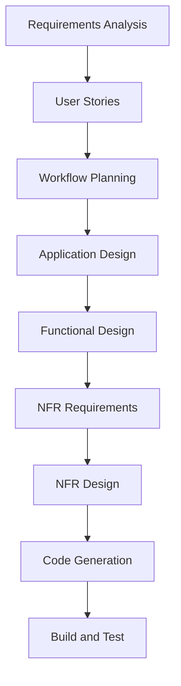

# Inception templates

**Re-read this file before writing an artifact.** If `aidlc-docs/templates/<artifact>.md` exists, use its headings instead.

**ID scheme.** IDs are permanent: never renumber them, and never reuse a deferred ID.

| Prefix | Meaning |
|---|---|
| `FR1`, `FR1.2` | functional requirement and sub-requirement |
| `NFR2` | non-functional requirement |
| `US1.3` | user story |
| `AC1.3.2` | acceptance criterion |
| `BR4` | business rule |
| `U1` / `u1-ideas` | unit ID and its folder name |

**Coverage statuses:** OK, GAP, ORPHAN, Deferred (with the user's reason), N/A (with a reason).

## requirement-verification-questions.md (excerpt)

```markdown
# Requirements Verification Questions

> Fill in a letter after each `[Answer]:` (X = other, then describe). Say "done", or "guide me".

## Q0. Taken from your documents. Please confirm
- Personas: employees, line managers (brief.md § Personas: "managers approve first")
A) Correct  B) Corrections below
[Answer]:

## Q1. [product] Team size and timeline for this Intent?
Context: used to right-size architecture and unit count. *Two-way door.*

A) 1-2 people, under 1 month

B) 3-6 people, 1-3 months

C) 7+ people or multiple teams

X) Other (please describe after [Answer]: below)

Recommended: B (from the README contributors list).

[Answer]:

## Q2. [product] How will we know it succeeded?
Context: becomes the Success Measures with baseline and target. *Two-way door.*
...

## Q8. [security] Apply the security baseline extension?
A) Yes, enforce it  B) No (prototype or internal tool)  X) Other
[Answer]:

## Decisions Summary
- Q1: B, 3-6 people, 1-3 months
```

Categories to cover, skipping any that are already clear:
- users and personas
- core capabilities
- success measures
- team size and timeline
- scope boundaries
- data and integrations
- volume and performance
- security and compliance
- availability
- existing constraints
- extension opt-ins

## requirements.md

```markdown
# Requirements

## Summary
<≤10 lines: intent, top FRs, key NFRs, biggest assumption, out of scope>

## Intent Analysis
- **Request**: "<verbatim user request>"
- **Clarity / Type / Scope / Complexity / Depth**: ...

## Intent
<2-4 sentences in business language. No technology choices unless a stated constraint.>

## Success Measures
| Metric | Baseline | Target | Check date | Source |
|---|---|---|---|---|
| Idea-to-decision time | ~14 days | < 5 days | launch + 60 days | [Q2] |

## Functional Requirements
- **FR1 Submit idea**: the system shall ... [desc]
  - **FR1.1**: ... [Q3]

## Non-Functional Requirements
- **NFR1 Performance**: p95 page load < 1.5 s at 200 concurrent users [Q5]

## Assumptions & Open Questions
| Item | Label | Reason / how to confirm |
|---|---|---|
| Users authenticate via existing SSO | Assumed | No question asked, because the repo already uses Okta. Confirm in Q-next. |

## Out of Scope
## Open Decisions
| ID | Decision | Owner | Blocking? |
```

Source tags:
- `[desc]`: the user's request
- `[Qn]`: an answer
- `[doc]`: the team's documents
- `[memory]`: `memory.md`
- `[assumption]`: never used as if confirmed

## stories.md

```markdown
# User Stories

## Summary
<≤10 lines: personas, story count by epic, coverage status>

## US1.1: Submit an idea
**Persona**: Employee   **Traces to**: FR1, NFR1   **Unit**: <set in Units Generation>

As an employee, I want to submit an idea with a title and description, so that it reaches the right approver.

- **AC1.1.1** Given I am signed in, when I submit a title (1-120 chars) and description, then the idea is saved as "Submitted" and I see it in My Ideas.
- **AC1.1.2** Given the title is empty, when I submit, then I see "Title is required" and nothing is saved.

## FR → Story coverage
| FR | Stories | Status |
|---|---|---|
| FR1 | US1.1, US1.2 | OK |
| FR4 | — | Deferred: "phase 2" (user, Q6) |
```

## execution-plan.md

````markdown
# Execution Plan

## Summary
- **Intent**: <one line>  **Profile / Depth / Test strategy**: feature / Standard / Standard
- **Risk**: Medium, because <reason>   **Impact**: user-facing, data model, API

## Stage Decisions
- [x] Requirements Analysis: COMPLETED
- [x] User Stories: COMPLETED
- [ ] Application Design: EXECUTE, because two new components are needed
- [S] Units Generation: SKIP, because there are 4 stories and one domain (below the thresholds)
- [ ] Functional Design (u1-ideas): EXECUTE, because of approval-chain rules
- [ ] NFR Requirements (u1-ideas): EXECUTE, because of SSO and audit
- [S] Infrastructure Design: SKIP, because the existing ECS service is reused
- [ ] Code Generation (u1-ideas): EXECUTE. Bolt type: ddd
- [ ] Build and Test: EXECUTE

## Flow

<!-- Text: Requirements → Stories → Planning → App Design → Functional → NFR Req → NFR Design → Code → Build & Test. Skipped: Units Generation, Infrastructure Design. -->

## Change Sequence (brownfield)
1. <component>: <change type>: <reason>

## Success Criteria & Quality Gates
## Open Decisions
````

## unit-of-work.md

```markdown
# Units of Work

## Summary
<≤10 lines: units, kinds, dependency order, skeleton>

## U1 / u1-ideas
- **Purpose**: idea lifecycle (bounded context)   **Kind**: service
- **Stories**: US1.1, US1.2, US2.1
- **Owned entities**: Idea, Vote   **Commands**: SubmitIdea, WithdrawIdea
- **Publishes**: IdeaSubmitted   **Consumes**: ApprovalDecided (from U2)
- **Interfaces**: REST /ideas (contract: ...)
- **Code location**: src/ideas/
- **Bolts**:
  1. *ddd*: walking skeleton (submit an idea end to end, persisted, listed). DoD: AC1.1.1 e2e green. Hypothesis: our SSO + DB setup works end to end.
  2. *simple*: withdraw and edit. DoD: AC1.2.* green.

## External dependencies
| Dependency | Owner | Lead time | Blocks | Fallback |
```
