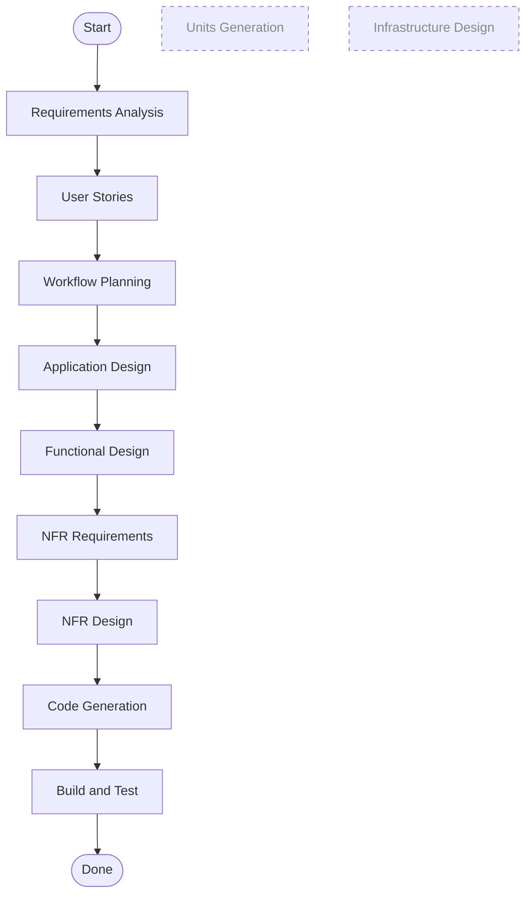

# Inception templates

## requirement-verification-questions.md (excerpt)

```markdown
# Requirements Verification Questions

> Fill in a letter after each `[Answer]:` (X = Other, then describe). Say "done" when finished, or "guide me" to answer in chat.

## Q1. [product] What problem does this solve, and for whom?
Context: anchors the Intent in business terms.

A) <option derived from the request>

B) <option>

X) Other (please describe after [Answer]: below)

[Answer]:

## Q2. [product] How will we know it succeeded?
Context: becomes the measurement criteria traced back to the Intent.

A) Adoption metric (e.g. % of employees submitting ideas per quarter)

B) Cycle-time metric (e.g. idea-to-decision under 5 days)

C) Cost or revenue metric

X) Other (please describe after [Answer]: below)

[Answer]:

## Q3. [security] What data sensitivity applies?
...
```

Cover these categories, skipping any that are already clear:
- users and personas
- core capabilities
- success metrics
- scope boundaries
- data and integrations
- volume and performance
- security and compliance
- availability
- existing constraints
- timeline and risk

## requirements.md

```markdown
# Requirements

## Intent Analysis
- **Request**: "<verbatim user request>"
- **Clarity**: clear | vague | incomplete
- **Type**: ... **Scope**: ... **Complexity**: ...
- **Depth**: Minimal | Standard | Comprehensive

## Intent
<2-4 sentences in business language: who, what capability, why it matters. No technology choices.>

## Success Measures
- <metric traced to the intent>

## Functional Requirements
- **FR-1 <name>**: <the system shall ...>

## Non-Functional Requirements
- **NFR-1 Performance**: <measurable target>

## Assumptions
## Out of Scope
## Open Risks
```

## stories.md

```markdown
# User Stories

## Story US-1: <title>
**Persona**: <persona>  **Traces to**: FR-1, NFR-2  **Unit**: <assigned in Units Generation>

As a <persona>, I want <capability>, so that <value>.

**Acceptance criteria**
- Given <context>, when <action>, then <observable outcome>
- Given ..., when ..., then ...

**Notes**: <edge cases, business rules>
```

## execution-plan.md

````markdown
# Execution Plan

## Summary
- **Intent**: <one line>
- **Profile / Depth**: feature / Standard
- **Risk**: Medium, because <reason>
- **Impact areas**: user-facing, data model, API

## Stage Decisions
- [x] Requirements Analysis: COMPLETED
- [x] User Stories: COMPLETED
- [ ] Application Design: EXECUTE, because two new components are needed (Idea, Approval)
- [S] Units Generation: SKIP, because there is a single Unit (modular monolith)
- [ ] Functional Design (unit: core): EXECUTE, because of approval-chain business rules
- [ ] NFR Requirements (unit: core): EXECUTE, because of SSO and audit requirements
- [ ] NFR Design (unit: core): EXECUTE
- [S] Infrastructure Design: SKIP, because the existing ECS service is reused
- [ ] Code Generation (unit: core): EXECUTE
- [ ] Build and Test: EXECUTE
- [S] Operations: SKIP, because the existing pipeline deploys it

## Flow



## Change Sequence (brownfield)
1. <component>: <change type>: <reason>

## Success Criteria & Quality Gates
- All acceptance criteria covered by automated tests
- No regression in existing test suite
````

## unit-of-work.md

```markdown
# Units of Work

## Unit: <name>
- **Purpose**: <bounded context in one line>
- **Stories**: US-1, US-3, US-4
- **Owned entities**: Idea, Vote
- **Provides**: <API/events other units consume>
- **Consumes**: <from which units>
- **Code location**: src/<unit>/ (greenfield)
- **Suggested Bolts**:
  1. Walking skeleton: submit idea end-to-end, persisted, visible in the list. DoD: e2e test green.
  2. Approval chain rules. DoD: all approval acceptance criteria pass.
```
